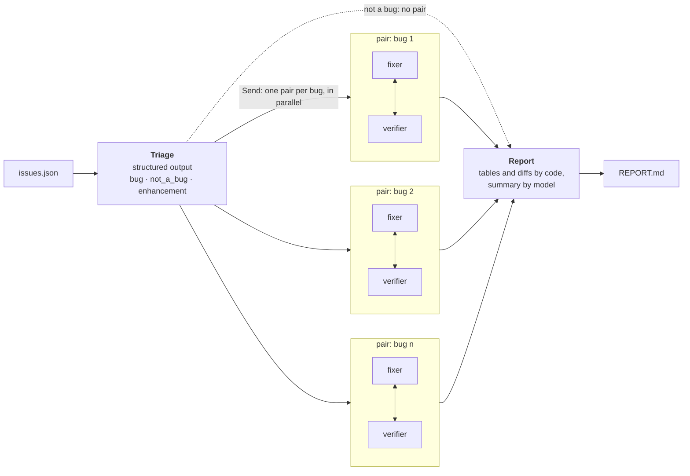
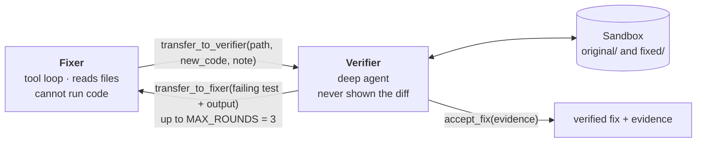
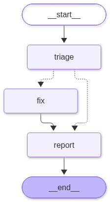

# Bug-Fixing Agent Team

A multi-agent system that works through the open issues of a Python repository. It triages each issue, fixes the real bugs, checks every fix in a sandbox, and writes a report for the maintainer. I also ran a controlled experiment to see whether splitting the work across a team of agents beats a single agent doing the whole job.

**Live demo:** https://bug-fixing-team-udfx.onrender.com
*(Free-tier Render instance. The first request after it has been idle takes about a minute while the instance wakes.)*

In the demo, pick one of the ten open issues, or **write your own issue** against `huskyutils` and watch the team triage it, fix it, and verify the fix live.

**The short answer from the experiment:** no. The team and the single-agent baseline resolved the same 9 of 10 issues, and both made one false claim. The team used about 2.6× the model calls. The interesting result is *why* the team's independent verifier didn't help: in both team runs, the false claim went **through** the verifier. That finding led to two concrete fixes, now in the app. In a re-run with those fixes, **the team made zero false claims** for the first time, while the baseline made one false claim in every run. Issues resolved stayed tied at 9/10, at about 3× the baseline's model calls.

---

## The task

`huskyutils` is a small pure-Python library with seven modules: shipping prices, payment splitting, delivery dates, interval merging, slugs, card text and statistics. Each function's **docstring is its specification**: if the code and the docstring disagree, the code is wrong. The library has 10 open issues, in GitHub API format:

- **7 are real bugs**, all in edge cases the existing tests don't cover.
- **2 report behavior the docstring actually promises**, so they are not bugs.
- **1 is a feature request.**

A good system has to fix the seven, *and* recognise the other three and leave their code alone.

---

## Architecture



**Inside one fixer–verifier pair:**



| Component | How it works |
|---|---|
| **Triage** | One structured-output call per issue. It reads the issue and the library code and returns a label with a reason. |
| **Fan-out** | LangGraph's `Send` dispatches each bug to its own fixer–verifier pair. Pairs run in parallel (`MAX_PARALLEL = 2`), each with its own context and its own sandbox. |
| **Fixer** | A LangGraph tool loop with three tools: `list_files`, `read_file`, and `transfer_to_verifier`. It **cannot run code**. A conditional edge stops it the moment it hands off. |
| **Verifier** | A `deepagents` deep agent whose backend is a sandbox (Daytona in production, Docker locally). It gets two copies of the repo, before and after the fix. It is told which file changed but **not shown the change**, so its test has to come from the issue and the docstring rather than from the fix. It writes a test, runs it in both copies, and ends with one of two `return_direct` handoffs: `accept_fix` with its evidence, or `transfer_to_fixer` with the failing test and its output. |
| **Report** | Code builds the issue table and the per-issue sections (diff, verifier evidence, verifier test) from what the agents recorded. A model writes only the summary paragraph. |

Why split the work at all? There are three reasons. A check is more useful when it's made by an agent that didn't write the fix. A rejected fix comes back with the exact failing test, which is what the fixer needs next. And separate contexts and sandboxes stop one fix from leaking into another. The experiment tests whether those benefits are worth the cost.

The team graph in LangGraph:

<p align="center"></p>

### The baseline

The baseline is a single `deepagents` deep agent with the same model and the same kind of sandbox. It gets all ten issues and the whole repository, and has to triage, fix, test and report on its own. It can run code, so it can check its own fixes; it just has no independent checker.

---

## Results

Both systems were scored against **hidden tests that neither system saw**.

| Metric | Definition |
|---|---|
| Resolved | Out of 10. A bug counts when all its hidden tests pass; a non-bug counts when it is labeled correctly and its documented behavior is unchanged. |
| Triage | Issues labeled correctly, out of 10. |
| Bugs fixed | Bugs whose hidden tests all pass, out of 7. |
| False claims | Fixes the system reported as fixed and checked, which the hidden tests reject. |

### Head to head: two runs of each system

| Run | Resolved | Triage | Bugs fixed | False claims | Model calls | Tokens | Time |
|---|---|---|---|---|---|---|---|
| Team (1) | 9/10 | 10/10 | 6/7 | 1 | 136 | 3,697,943 | 920 s |
| Baseline (1) | 9/10 | 10/10 | 6/7 | 1 | 47 | 504,064 | 149 s |
| Team (2) | 9/10 | 10/10 | 6/7 | 1 | 119 | 593,502 | 318 s |
| Baseline (2) | 9/10 | 10/10 | 6/7 | 1 | 52 | 641,464 | 162 s |

All four runs triaged every issue correctly and left the three non-bugs unchanged. Each run missed exactly one bug, **and reported that bug as fixed and checked**:

| Run | Failed issue | What went wrong |
|---|---|---|
| Team (1) | #2 `split_amount` | Gives the extra cent to the *last* share: `split_amount(1000, 3)` returns `[333, 333, 334]`, but the docstring says `[334, 333, 333]`. |
| Team (2) | #2 `split_amount` | Positive amounts are right, but refunds get the extra cent on the wrong end: `split_amount(-1000, 3)` returns `[-333, -333, -334]`, but the docstring says `[-334, -333, -333]`. |
| Baseline (1) | #1 `slugify` | Never strips accents: `slugify("Crème Brûlée Mug")` returns `crème-brûlée-mug`, not the docstring's `creme-brulee-mug`. |
| Baseline (2) | #2 `split_amount` | Refunds don't sum correctly: `split_amount(-1000, 3)` returns `[-335, -334, -334]`, which totals −1003. |

**The team did not do better.** The systems tied on resolved issues and on false claims in both runs. With ten issues and two runs each, even a one-issue gap would have been indistinguishable from run-to-run noise, and there was no gap at all.

### Cost

| | Calls (run 1 / run 2) | Tokens (run 1 / run 2) | Time (run 1 / run 2) |
|---|---|---|---|
| Team | 136 / 119 | 3,697,943 / 593,502 | 920 s / 318 s |
| Baseline | 47 / 52 | 504,064 / 641,464 | 149 s / 162 s |

The team made about **2.6× the model calls** in both runs and took 2–6× the wall-clock time. Its token count was much less stable: 7.3× the baseline in run 1, slightly below it in run 2. On the Gemini free tier (500 requests a day), one team run uses about a quarter of the daily quota, against about a tenth for the baseline.

### Why the verifier didn't catch the false claims

In both team runs, the wrong fix was **accepted by the verifier**. The verifier passes a fix if its own test passes, and both times it wrote a test that contradicted the docstring:

- **Team run 1:** the verifier asserted `split_amount(1000, 3) == [333, 333, 334]`, the issue reporter's *suggested* behavior, where the docstring says `[334, 333, 333]`.
- **Team run 2:** the verifier asserted `split_amount(-1000, 3) == [-333, -333, -334]`, the fix's own output, rewriting the docstring's example so that the fix would pass.

**The one handback made things worse.** In team run 1, the fixer's first attempt was correct by the docstring: the first shares get the extra cent. The verifier rejected it because it didn't match the reporter's suggestion to give the extra cent to the last share. The fixer complied, the verifier accepted the new fix, and the hidden tests failed it. The handoff mechanism worked exactly as designed, and it turned a correct fix into a false claim.

A verifier is only as good as the test it writes. When it treats the issue text, or the fix's output, as the specification, it blesses a wrong fix and adds a "verified" stamp that makes the false claim more convincing. The baseline's false claims came from the opposite gap: it tested only the issue's example and never ran the docstring's other examples.

### What I changed afterward

The verifier prompt already called the docstring "the specification" and asked for "every example in the docstring". With `gemini-3.5-flash-lite`, that instruction didn't hold. The deployed app adds two fixes:

1. **A tie-break rule in the verifier prompt:** *"If the issue's suggestion contradicts the docstring, follow the docstring."* Issue #2 is exactly that conflict, and the original prompt never said which side wins.
2. **A docstring gate in code, not in the prompt.** Before an `accept_fix` stands, the system parses every `f(...) == expected` example out of the *original* file's docstrings, so the fixer can't edit them away. It runs them against `fixed/` in the sandbox, and any failure turns the accept into a rejection, with the failing examples sent back to the fixer.

The gate would have caught all four failures above, the baseline's included. The results above are for the original verifier.

### Re-run with the improved verifier

I re-ran the team with both changes in place, alongside fresh baseline runs: same model, same issues, Docker sandboxes, scored against the same hidden tests.

| Run | Resolved | Triage | Bugs fixed | False claims | Model calls | Tokens | Time |
|---|---|---|---|---|---|---|---|
| **Team, improved verifier** | 9/10 | 10/10 | 6/7 | **0** | 169 | 733,096 | 418 s |
| Baseline (a) | 9/10 | 10/10 | 6/7 | 1 | 57 | 723,914 | 201 s |
| Baseline (b) | 9/10 | 10/10 | 6/7 | 1 | 51 | 566,422 | 172 s |

**The team made no false claims, for the first time in any run.** Every fix it called verified passed the hidden tests. The baseline made one false claim in both runs, as it has in every run so far.

- **#2 `split_amount` is fixed.** This bug produced a false claim in every earlier team run. This time the gate rejected the fixer's refund handling twice: *"split_amount(-1000, 3) == [-334, -333, -333]  # got [-333, -333, -334]"*. The fixer corrected it, and the hidden tests pass.
- **#4 `add_business_days` was rejected by a bug in the gate, not in the fix.** One docstring example ends with a comment (`# Monday`), which the gate pasted into its check script, commenting out a closing parenthesis. The examples also use `date`, which `dates.py` never imports. Every check failed, and the fix was sent back until the rounds ran out. The team reported #4 as **not** fixed, so it is a miss but not a false claim. The fixer's final code passes both #4 hidden tests.

So the team resolved the same 9/10 as the baseline, but traded the baseline's false claim for an honest miss, at about 3× the model calls.

**I've fixed the gate since.** It now rebuilds each example from its syntax tree, which drops comments; supplies the `datetime` names examples rely on; and skips, rather than fails, any example it can't evaluate. Replaying every final fix from both team runs through the fixed gate, without a model, matches the hidden tests on **14 of 14 fixes**. That includes rejecting the original run's wrong #2 fix and accepting the #4 fix it had wrongly rejected. That points to 10/10 with no false claims for this run, but it's a replay of the final fixes, not a full re-run, so I don't count it as a measured result.

### Experiment conditions

| Setting | Value |
|---|---|
| Model | `gemini-3.5-flash-lite` for every role in both systems, on every run |
| Runs | 2 per system |
| Sandbox | Team run 1 on Daytona; baseline run 1 and both second runs on Docker. Scoring uses the same hidden tests either way, so the scores are comparable, but wall-clock times are not directly comparable across sandboxes. |
| Team settings | `MAX_ROUNDS = 3` verifier→fixer handbacks per issue, `MAX_PARALLEL = 2` |
| Scoring | Hidden tests plus labeled answers, neither visible to either system |

---

## The app

The Gradio app has two tabs:

- **One issue:** pick an open issue, or write your own, and press **Fix**.
- **All issues:** run the whole team, with the pairs working in parallel.

Both tabs stream the run as it happens: triage's label and reasoning, then the fixer and verifier handing the fix back and forth as a chat. The maintainer's report for the issue appears when the run finishes.

---

## Tech stack

- **LangGraph**: the team graph, the `Send` fan-out, and the fixer–verifier pair graph
- **deepagents**: the verifier and the baseline
- **LangChain 1.x**: tools, `return_direct` handoffs, structured output with Pydantic
- **Daytona**: cloud sandboxes in production. **Docker**: local sandboxes
- **Google Gemini** (`gemini-3.5-flash-lite`): the model for every role
- **Gradio**: UI. **Render**: hosting

---

## Project structure

```
app.py              Gradio entry point
bugteam_ui.py       the two-tab UI: live handoff stream and report
bugteam/
  config.py         model, sandbox choice, MAX_ROUNDS, MAX_PARALLEL
  team.py           triage, Send fan-out, report, team graph
  pair.py           the fixer–verifier pair graph and its routing
  fixer.py          the fixer's tools and loop
  verifier.py       the verifier deep agent, handoff tools, docstring gate
  baseline.py       the single deep-agent baseline
  sandbox.py        sandbox lifecycle and file helpers (Daytona or Docker)
  docker_sandbox.py local Docker sandbox backend
  repo.py           loads the repo and issues, builds diffs
  evaluate.py       scoring against the hidden tests
  util.py           rate-limit retry, CallCounter for calls and tokens
repo/               huskyutils: the library under repair, and its tests
issues.json         the 10 open issues
```

---

## Running locally

```bash
python -m venv .venv && source .venv/bin/activate
pip install -r requirements.txt
```

Create a `.env` file:

```env
GOOGLE_API_KEY=...
DAYTONA_API_KEY=...      # or set SANDBOX=docker to use local Docker instead
```

```bash
python app.py            # http://localhost:7860
```

With `SANDBOX=docker`, each verification runs in a local `python:3.12-slim` container, so Docker must be running. The sandbox gets no network access and no API keys, because the verifier runs code a model wrote.

## Deployment

The app deploys to Render as a Blueprint from `render.yaml`. Choose **New + → Blueprint**, pick the repo, and enter `GOOGLE_API_KEY` and `DAYTONA_API_KEY` when prompted. Render has no Docker, so production uses Daytona sandboxes. Each verification takes about half a minute of sandbox time, and the sandbox is deleted when it finishes.

---


